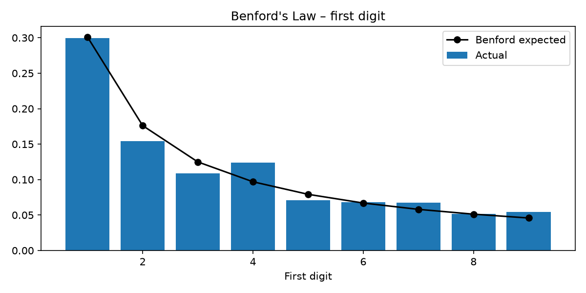
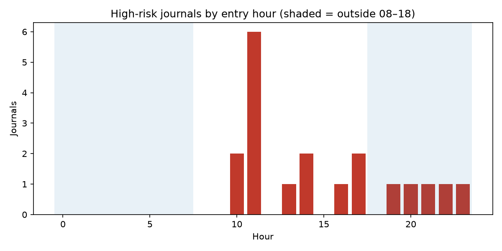
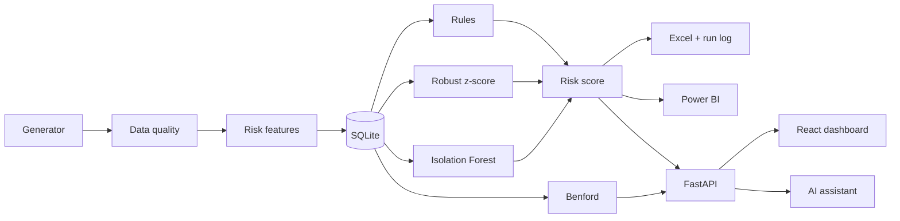

# Audit Tech AI

**Journal Entry Testing under ISA 240, combining rule-based tests, statistics, machine learning and an AI assistant.**

**[Try the live application →](https://audit-tech-ai-ip213.azurewebsites.net)**
Open the dashboard and ask the audit agent a question, for example *"Which are the 3 riskiest journals?"*
The demo runs on a free tier, so the first load may take around 30 seconds.


> Independent portfolio project by Ioannis Papadakis, prepared for the Deloitte Greece Assurance – Data Analyst application.
> All data is synthetic. Not affiliated with or endorsed by Deloitte.

---

## Objective

ISA 240 requires auditors to respond to the risk of management override of controls, which includes testing the
appropriateness of journal entries. Manual sampling covers only a fraction of the population. This project tests
**all 3,173 journals** of a synthetic FY2025 ledger and produces a ranked list of **19 high-risk journals** for
auditor follow-up, together with the evidence needed for the audit file.

## Results

| Metric | Value |
|---|---|
| Ledger lines / quarantined | 8,119 / 16 |
| Journals tested | 3,173 |
| High-risk journals (score ≥ 6) | 19 |
| Precision / recall at threshold 6 | 1.00 / 0.32 |
| Precision / recall at threshold 1 | 0.81 / 1.00 |
| General Ledger vs Trial Balance difference | 0 |
| Benford MAD: all accounts / account ACC_04 | 0.0106 (acceptable) / 0.0230 (nonconformity) |

<p align="center">
  
  
</p>

## Methodology

**1. Data and ground truth.** A reproducible generator (seed 42) creates a General Ledger and Trial Balance and
plants 13 known anomaly types. Because the anomalies are known, detection quality is measured rather than assumed.

**2. Data quality before analysis.** The ledger is rolled forward and reconciled to the Trial Balance; if they do
not agree, the pipeline stops, since incomplete data invalidates every later test (ISA 500, completeness).
Lines failing validation are quarantined at journal level. Nothing is deleted or corrected automatically.

**3. Risk indicators.** Each line is enriched with the ISA 240 fraud-risk characteristics: weekend, holiday and
after-hours posting, proximity to year-end, round amounts and manual entry.

**4. Detection layers.** Each layer addresses a different type of risk:
- *Rules (10 SQL tests)* capture known red flags, such as postings by unauthorised users, the same user creating
  and approving a journal, or manual entries in the last days of the year.
- *Robust z-score* (median and MAD per account) identifies amounts that are unusual for their account, without
  being distorted by the outliers it is trying to find.
- *Isolation Forest* identifies journals that are unusual in combination, covering patterns no rule anticipated.
- *Benford's Law* tests first-digit distributions against Nigrini's MAD thresholds to flag accounts whose amounts
  may not arise naturally.

**5. Risk scoring.** Rule results are weighted into a single score per journal. The threshold of 6 is a
professional-judgement trade-off: at threshold 1 every planted anomaly is found (recall 1.00) but the team must
clear more false positives; at threshold 6 every flagged journal is a true anomaly (precision 1.00).

**6. Evidence.** Each run produces an Excel working paper and a run log with SHA-256 hashes of all inputs and
outputs, so results can be reproduced and verified.

**7. Reporting.** A star-schema model feeds Power BI (DAX measures validated against the Python results), a
FastAPI service and a React dashboard. All channels read the same outputs, so they always report the same figures.

## AI assistant

The assistant answers auditor questions by calling tools over the verified results rather than generating answers
from memory. Its design follows audit requirements:

- **Read-only.** The only tools are `get_stats`, `get_anomalies` and `get_benford`; it cannot modify data.
- **Data minimisation.** It receives aggregates and the high-risk list, never the full ledger.
- **Controlled execution.** Tools are executed by application code, unknown tools are refused and result sizes are capped.
- **Traceability.** Each answer records which tools were used.
- **Human judgement.** It flags risks for review and is instructed not to conclude that fraud has occurred.
- **Resilience.** If the AI provider is unavailable, it retries once and then returns a clear message.

## Architecture and deployment



The application runs on **Azure App Service** in France Central, keeping data within the EU. FastAPI serves both
the API and the React build from a single address. The AI key is stored in the App Service configuration and is
never committed to the repository.

## Running locally

```bash
git clone https://github.com/IoannisPapadakis213/audit-tech-ai.git
cd audit-tech-ai
python3.12 -m venv venv && source venv/bin/activate
pip install -r requirements.txt

cd backend
python -m audit_ai.pipeline              # run the full analysis
python -m pytest -q                      # 79 tests
uvicorn audit_ai.api:app --reload        # API at http://127.0.0.1:8000/docs

cd ../frontend                           # in a second terminal
npm install && npm run dev               # dashboard at http://localhost:5173
```

The AI assistant requires a Gemini API key in a `.env` file (see `.env.example`).

## Next steps

- Run the same pipeline on Databricks or Microsoft Fabric to process millions of lines.
- Add CI/CD so tests run on every change and deployment happens only when they pass.
- Extend the test library: duplicate payments, vendor master-data changes and segregation-of-duties analysis.

---

Ioannis Papadakis · [GitHub](https://github.com/IoannisPapadakis213)
